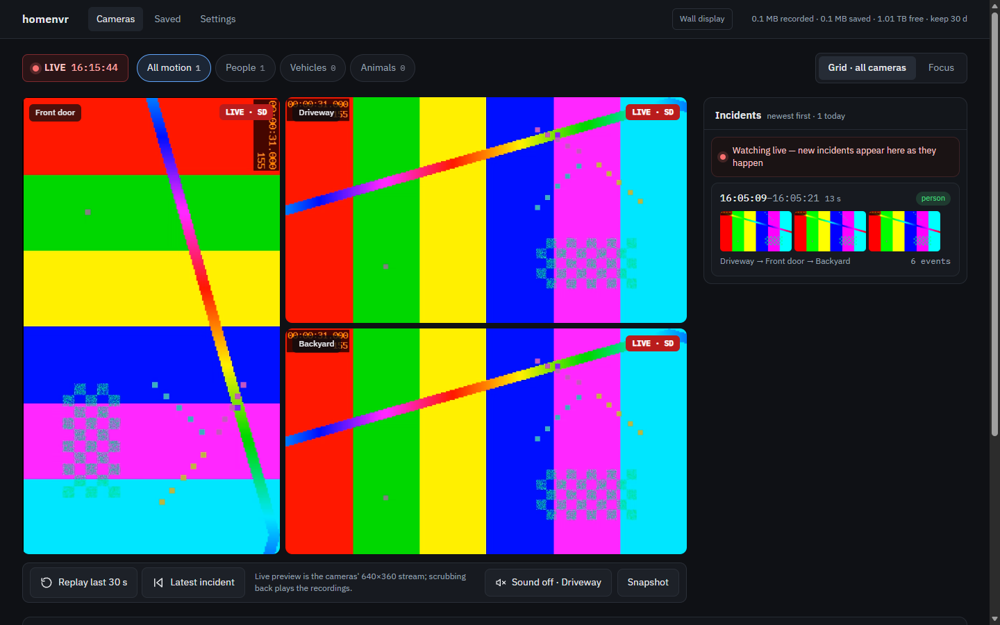

# homenvr



A self-hosted replacement for the Hikvision phone app. homenvr records your
cameras straight to your own server over RTSP, so you get **unlimited storage**
(NAS / rack disk), **fast local playback**, a **motion timeline**, **push alerts
with snapshots**, and **remote access** — with no cloud relay, no ads, and no
upselling.

Built and tested against a **DS-7804N-S1/W(B)** NVR with three
**DS-IPC-K24H-LWT** cameras. It should work with any Hikvision NVR or IP camera,
and with other RTSP cameras through per-camera `record_url` / `live_url` — with
any number of cameras, from one up. See [PROTOCOL.md](PROTOCOL.md) for how the
device was investigated and how the camera↔NVR communication works.

> Not affiliated with or endorsed by Hikvision. homenvr only **reads** streams
> from your NVR using credentials you supply; it never modifies the device or its
> firmware.

## Why

The stock app routes video through the Hik-Connect cloud even on your own LAN
(the NVR's web/SDK ports are typically closed), which makes playback slow and
flaky, and the SD card fills in days. homenvr connects **directly over LAN RTSP**
and stores recordings on hardware you control.

## Features

- **Cameras page** — one page for live and review. Live: multi-camera wall,
  **WebRTC** (~1 s behind) with HLS fallback, per-camera rotate, digital
  zoom/pan, focus view, sound. Review: incidents list, per-camera swimlanes with
  motion marks, event thumbnails, synchronized multi-camera playback. Works on
  phones.
- **Playback** — local recordings, no "failed to grab recording". H.264 recordings
  (and HEVC, in browsers that decode it) play the original 2K stream directly;
  otherwise the server transcodes to H.264 on the fly.
- **Motion detection** — server-side, on the sub-stream (no NVR changes): an event
  when a share of the picture (default 1 %, per camera) clearly changes for 0.4 s —
  camera exposure steps and compression pulses don't count, a distant walker does —
  then **YOLOX-tiny** object detection labels each event person /
  vehicle / **animal** (any animal: birds, cats, dogs, deer-sized animals — one
  category). Only *moving* objects seen in 2+ frames count, and vehicles or
  animals that never moved during the burst (parked cars, covered furniture,
  railings with shadows) are ignored.
- **Detection boxes** — each event keeps what moved in its ~10 s burst: labelled
  detections (green person, amber vehicle, purple animal) and unexplained moving
  areas (dashed). Drawn into thumbnails and push photos, and over review
  playback in sync (*Boxes* toggle) — the quick way to dismiss shadow/foliage
  noise. The camera's clock overlay is recognised and never boxed.
- **Incidents** — events of all cameras clustered into incidents (2-min split),
  noisy single-camera stretches folded into "busy" periods, false alarms
  dismissable.
- **Push alerts** — ntfy, Discord/Slack webhook, Telegram, or email: health
  alerts (camera stopped recording, disk full, homenvr using too much memory) and **photo pushes on motion**,
  filtered by `push_on` (person / person or vehicle / person or animal / person,
  vehicle or animal / any motion), per camera.
  With a *Public address* set, each push links to the event (`/?play=<t>&cam=<id>`).
- **Ignore zones** — per camera, drawn over a snapshot; each ignores motion and/or
  people, vehicles & animals standing in it (a street: detections only, so a walker
  on the sidewalk still triggers; a BBQ cover in the wind: motion only), or keeps them
  labelled but doesn't push for them (a sidewalk's passers-by).
- **Exact seeking** — review starts at the exact second you pick; saved clips
  play from a seekable copy. Safari/iPhone/iPad get Range-capable files.
- **Clip export + permanent "saved" clips** — never auto-deleted, with thumbnails
  and an in-page player. **Auto-saved clips**: every pushed event keeps a clip
  of each camera that saw it (10 s before to 30 s after), with their own limits
  (default 90 days / 50 GB); *Keep* makes one permanent.
- **Two-stage retention** — footage past your day/size limits moves to a **grace**
  area (reversible), and is hard-deleted only under real disk pressure.
- **Remote access** — Tailscale sidecar (HTTPS on your tailnet, WebRTC included);
  no cloud, no open ports. See [docs/remote-access.md](docs/remote-access.md).
- **Settings page** — alerts, push policy, public address, motion sensitivity
  (global and per camera), ignore zones, retention, auto-save, camera
  names/rotation; changes apply live. A read-only *Server configuration* card
  shows `config.yml` and the `.env` variables (secrets masked), with a
  *Restart homenvr* button.
- **SD-card backfill** — import footage already on the NVR before it rotates away.

## Requirements

- A Linux host with Docker + Docker Compose (a NAS, a rack server, a mini PC…).
- Network reachability to the NVR/camera.
- The NVR **admin password** (RTSP credentials). On modern Hikvision devices the
  password was set at activation — there is no factory default.

## Quick start

```bash
git clone https://github.com/ushiosoft/homenvr.git
cd homenvr
cp .env.example .env              # set NVR_PASSWORD, UI_PASSWORD, TZ, RECORDINGS_DIR
cp config.example.yml config.yml  # set the NVR address and your cameras
docker compose up -d --build
# with remote access: set COMPOSE_PROFILES=tailscale and TS_AUTHKEY in .env, then the same command
```

Open `http://<host>:8971` (or from your phone on the same network). Log in with
the UI credentials from `.env`. Point `RECORDINGS_DIR` at your NAS/disk for
unlimited storage.

## Configuration

`config.yml` is the base config (secrets come from `.env` via `${VAR}`). The
**Settings** page writes a runtime overlay for alerts/motion/retention, so you
rarely need to edit the file after setup. Key sections:

```yaml
nvr: { host: 192.168.1.64, port: 554, username: admin, password: ${NVR_PASSWORD} }
cameras:                                    # one entry per camera (at least one)
  - { id: cam1, name: Front door, channel: 1 }
  - { id: cam2, name: Driveway,   channel: 2, rotation: 90 }
retention: { max_days: 30, max_gb: 0, min_free_gb: 20 }   # past a limit: grace first, then deleted
motion:    { enabled: true, sensitivity: 1.0, detect: true }   # % of the picture; person/vehicle/animal labels
alerts:    { notifier: ntfy, ntfy_url: "https://ntfy.sh/your-topic", motion_push: true, push_on: person }
ui:        { username: admin, password: ${UI_PASSWORD} }
webrtc_api: http://go2rtc:1984                             # go2rtc sidecar; empty = HLS only
```

`push_on` is `person`, `person_vehicle`, `person,animal`, `person,vehicle,animal`
or `motion` (every event), globally or per camera. See `config.example.yml` for
every option (per-camera `live_codec`/`audio`, custom RTSP URLs, SMTP/Telegram,
auto-save limits…).

Any number of cameras works, from one up; how the Cameras page lays them out is
described in [docs/multi-camera-view.md](docs/multi-camera-view.md).

### Backfill the SD card

```bash
docker compose exec homenvr python -m app.importer \
  --camera cam1 --from "2026-10-01 00:00" --to "2026-10-02 00:00"
```

## How it works

```
NVR ──main (2K)──────────────► homenvr recorder ──► 10-min MP4 files (/recordings)
    ──sub (640x360)──► go2rtc ─┬─ WebRTC ──────────► browser (live, ~1 s)
                               └─ RTSP restream ──► homenvr: live HLS + motion
                                                      └─ event ─► YOLOX burst ─► push
```

- **Recording**: one ffmpeg per camera stream-copies the main stream into
  fragmented MP4 files of `segment_seconds` (no re-encode).
- **go2rtc sidecar** (`docker-compose.yml`, `go2rtc.yaml`, `app/webrtc.py`): homenvr
  registers each camera's sub-stream at runtime (credentials stay in homenvr's
  config; `go2rtc.yaml` is mounted read-only and holds none). H.264 sub-streams
  are passed through; H.265 ones are converted once to H.264 (1 s keyframes) +
  Opus. go2rtc serves WebRTC (signalling proxied through homenvr's
  `/api/cameras/{id}/webrtc`, behind its login; only the media port 8555 is
  published) and an internal RTSP restream that the live-HLS and motion workers
  read. That keeps the NVR at two streams per camera; if go2rtc is down the
  workers read the NVR directly and retry go2rtc every 5 minutes.
- **Motion → labels → push**: the motion worker scores frame differences at 5 fps;
  on an event homenvr waits ~4.5 s, decodes a ~10 s burst (2 fps) from the live
  HLS segments, runs YOLOX-tiny on each frame, keeps the best frame (person, else
  vehicle, else animal) as the event thumbnail and push photo, and pushes if the
  camera's `push_on` policy matches. About 20 s later a second pass on the full-
  resolution recording refines the labels and boxes, and sends a late push if it
  finds what the first pass missed.
- **Review playback**: H.264 recordings are remuxed (stream copy, ~0 CPU) from the
  keyframe before the requested time; HEVC is direct-played in browsers that
  support it, else transcoded to 720p/480p H.264.

Details of the NVR protocol and the discovery process are in
[PROTOCOL.md](PROTOCOL.md); feature history and open items in [ROADMAP.md](ROADMAP.md).

| Component | Role |
| --- | --- |
| `app/recorder.py` | ffmpeg supervision (record + live), snapshots, event frame bursts |
| `app/webrtc.py` | go2rtc stream registration, preload, WebRTC signalling |
| `app/storage.py` | segment index, two-stage retention, grace/saved, export |
| `app/motion.py` / `app/events.py` | motion detection + event store |
| `app/detect.py` | YOLOX-tiny person / vehicle / animal labelling |
| `app/incidents.py` | clustering events into incidents / busy periods |
| `app/zones.py` | per-camera ignore zones (detection filter + motion mask) |
| `app/clips.py` | saved clips: keyframe-aligned cuts, seekable copies, auto-save |
| `app/serverinfo.py` | masked config/env for the Settings page |
| `app/alerts.py` | notifiers (ntfy/Discord/Telegram/SMTP) + health watchdog |
| `app/settings.py` | runtime-editable config overlay |
| `app/main.py` | HTTP API + web UI |
| `app/static/` | single-page UI |

## Camera settings

Set these per camera in the Hik app / NVR (Configuration → Video):

| Stream | Codec | Resolution | FPS | I-frame interval | Bitrate |
| --- | --- | --- | --- | --- | --- |
| Main | H.264 (H.264+ off) | 2K | 12 | 24 | VBR, cap ~4096 kbps |
| Sub | H.264 | 640x360 | 10-12 | 12 | VBR, cap ~512 kbps |

Why: H.264 main plays the original 2K in every browser with no server CPU (HEVC
needs a transcode in most browsers — ~0.7 core per viewer on an old Xeon); an
H.264 sub-stream is passed through by go2rtc instead of being transcoded. A 2 s
keyframe interval keeps seeking precise. H.264 roughly doubles storage versus
H.265 (~17 GB/day per camera at these settings). Use CBR only for a camera
whose Wi-Fi link is marginal. Turn the NVR's own motion detection off (homenvr
does its own) and NTP on.

After changing a camera, the recorder and go2rtc reconnect by themselves (go2rtc's
codec is re-checked every 10 minutes; restart homenvr to apply at once).

## Deployment notes

- A typical server install: code + `.env` + `config.yml` in `~/srv/homenvr` (a git
  clone), data in `RECORDINGS_DIR` (recordings, `grace/`, `saved/`, `thumbs/`,
  `events.db`, `settings.json`). An older 8-core Xeon without AVX handles three
  cameras; each camera adds two ffmpeg readers and, with `live_codec: h264`, one
  small transcode.
- Update: `git pull && docker compose up -d --build` (with `COMPOSE_PROFILES=tailscale`
  in `.env`, the Tailscale sidecar comes up too).
  When `go2rtc.yaml` changed, add `--force-recreate go2rtc` (git replaces the file;
  a bind-mounted single file keeps pointing at the old one).
- Containers: `homenvr` (UI/API on :8971), `homenvr-go2rtc` (WebRTC media on 8555
  tcp+udp; API 1984 and RTSP 8554 internal only), `homenvr-tailscale` (tailnet
  node `homenvr`; `TS_HOSTNAME` is pinned — don't change the name with
  `tailscale set --hostname`).
- `.env` must set `WEBRTC_LAN_IP` (the server's LAN IP) and `WEBRTC_TS_IP` (the
  sidecar's tailnet IP) so browsers on the LAN and the tailnet reach go2rtc.
- The homenvr container is capped at 4 GB of memory (`HOMENVR_MEM_LIMIT` in `.env`,
  no swap beyond it): if it ever balloons it is restarted on its own instead of
  dragging the whole host into swap.
- Only one homenvr may run per NVR + tailnet name: a second instance would record
  twice, push twice and fight for the Tailscale name.

## Development

```bash
pip install -r requirements-dev.txt
pytest                       # unit tests
sh tests/e2e/check.sh        # end to end, in Docker (~2 min)
```

The e2e stack runs MediaMTX as a fake Hikvision NVR fed by three synthetic
cameras, and checks record → live → playback → export through the API.

## Status and limitations

- Used daily with one Hikvision NVR and three Wi-Fi cameras; other setups are
  less tested — issues and pull requests are welcome.
- No ONVIF discovery: cameras are listed in `config.yml` by NVR channel or RTSP URL.
- Every camera tile streams continuously; beyond ~9 cameras the browser and the
  server's playback transcodes get busy (see
  [docs/multi-camera-view.md](docs/multi-camera-view.md)).
- Motion detection is frame differencing on the sub-stream: very small subjects
  (a rabbit at night) may not trigger it.
- The container runs as root (it writes to the recordings volume).

## Security

- Set a strong `UI_PASSWORD` before exposing homenvr beyond your LAN; prefer
  Tailscale/Cloudflare Access over a bare port-forward.
- Keep the NVR off the public internet — homenvr is the only thing that needs to
  be reachable, and only to you.
- `.env`, `config.yml`, `recordings/`, and the settings overlay are gitignored.
- Found a vulnerability? See [SECURITY.md](SECURITY.md).

## License

MIT
